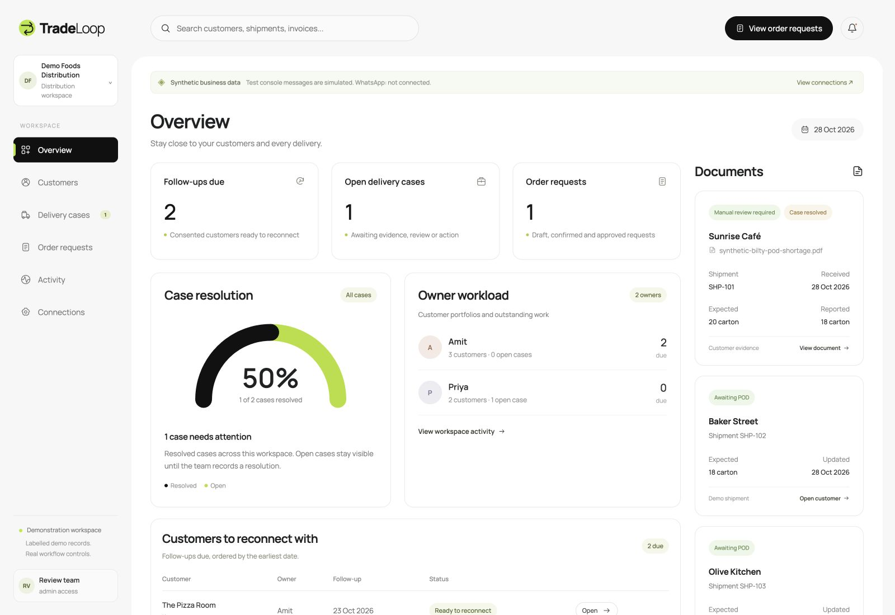

# TradeLoop

**Ask about the next delivery, understand why orders slowed, and give the team a next action.**

TradeLoop is an AWS-hosted distributor prototype. A dedicated **Sales follow-ups** tab lists due check-ins: staff ask whether the next delivery is needed and why a customer is waiting. The customer's exact statement stays beside a categorized reason, responsible owner and suggested next action. Workspace counts help the brand team review recorded feedback. Factual order context, repeat-order requests and delivery complaints share the same customer record.

Current deployed application source is [`935e607`](https://github.com/devotedayush/tradeloop/commit/935e607). Local `npm run verify` passed **109 tests**, type checking, production build and Lambda bundle. Current [CI run 40754087697](https://github.com/devotedayush/tradeloop/actions/runs/40754087697) succeeded. [Sales/context verification](docs/sales-context-verification.json) passed **21 read-only cloud checks** at judge revision **74**, reconfirmed by a final state read. The corrected 23-step GUI take matched all expected states with zero browser errors. The [180-second public demo](https://www.youtube.com/watch?v=ROkGlIfyKMk) is published on the Ayushman channel. The local H.264 export played to completion without error; signed-out public playback started successfully at 3:00 duration. English captions are burned into the video. See [video verification](docs/demo-video-verification.json).

**Operational demo records are synthetic.** A separate private source-review case contains an owner-authorized original invoice, excluded from repository fixtures. The deployed dashboard uses real Cognito, DynamoDB, Bedrock, S3 and Textract. **Live WhatsApp text replies and PDF evidence processing were verified on 28 October 2026.** The active AWS End User Messaging Social account is in Mumbai; the application runs in Virginia. Three real inbound texts (two status enquiries and a shortage complaint) traversed SNS, cross-region ingestion, SQS FIFO, the worker, Bedrock and DynamoDB, and three text replies were visually confirmed in desktop WhatsApp. One incoming forwarded synthetic PDF was retrieved, stored privately and extracted by Textract; the linked case moved to staff review with 20 expected and 18 reported cartons. POD remains missing and follow-ups remain paused. The document acknowledgement was also visually confirmed in WhatsApp at 22:45 IST. See the sanitized [WhatsApp verification record](docs/whatsapp-verification.json). Approved-template delivery remains unverified, and SES is disabled. This verifies actual CDS runtime use; it does not establish hackathon eligibility or completed submission.

## Working application

Dashboard: https://lhswn6utwl.execute-api.us-east-1.amazonaws.com

Staff data requires authentication. A dedicated `judgedemo` workspace has been provisioned with synthetic data only. It contains no original invoice or live WhatsApp contact binding. Its credentials are stored privately in the gitignored `.runtime/judge-access.json`; supply them through private judge testing instructions, never this README. Judge sign-in and the separate workspace were verified in the live browser; cloud tests also verified isolation from the owner workspace. The public URL alone does not expose customer records or credentials.

Start with the [judge guide](docs/judge-guide.md) for exact workflow inputs, expected states, verification evidence and reproducibility commands.

## Interface

The CRM workspace has Sales follow-ups, customer conversations, a factual latest-recorded-purchase summary, a record-backed resolution gauge, owner workload and delivery-document cards. Sales follow-ups shows due dates, blocked check-ins, exact customer feedback and one latest categorized reason per customer for the brand team. Header search finds customers by name, shipment, carrier or invoice reference. The layouts adapt to desktop, tablet and mobile. Manrope is bundled locally under its included OFL license.



These earlier screenshots show local synthetic workflow records and predate the latest sales/context additions. Live AWS/WhatsApp evidence is recorded separately in the verification files.

## Run locally

Requires Node.js 22.12 or newer and npm.

```sh
npm ci
npm run build
npm run dev
```

Open http://127.0.0.1:4310. Local mode binds to loopback, stores data in `.runtime/`, and uses a visibly labelled deterministic rules interpreter unless a Bedrock model is configured. Local mode has no staff login; never expose it as a production server.

Optional frontend hot reload: run `npm run web` in another terminal; Vite proxies `/api` to the local backend.

To test Bedrock locally with your configured AWS credentials, set `BEDROCK_REGION` and `BEDROCK_MODEL_ID` to an enabled, tool-capable model or inference profile before launching the backend. The deployed prototype was verified with `us.amazon.nova-pro-v1:0` in `us-east-1` on 28 October 2026. Confirm current availability in your own account.

## Validate

```sh
npm run typecheck
npm test
npm run build
npm run bundle
npm run synth
```

At source `935e607`, local `npm run verify` passed **109 tests**, type checking, production React build and Lambda bundle. Coverage includes sales-feedback distinctions, seven-day deferral, factual order updates, unique shipment context, permissions, opt-outs, duplicate events, stale approvals, quantity ambiguity, persistence concurrency, isolation and reset protection. Fresh [sales/context verification](docs/sales-context-verification.json) passed 21 read-only cloud checks after the corrected 23-step GUI take. This does not establish customer impact or load capacity.

Earlier evidence remains available: [cloud workflow rehearsal](docs/cloud-verification.json), [16 read-only judge rehearsal checks](docs/judge-rehearsal-verification.json), [12 read-only owner-cloud checks](docs/final-readiness-verification.json), and [live WhatsApp/PDF checks](docs/whatsapp-verification.json). These predate the latest sales/context work. [CI run 40748471874](https://github.com/devotedayush/tradeloop/actions/runs/40748471874) passed the earlier 66-test snapshot at `5ecb6a3`; current-source [CI run 40754087697](https://github.com/devotedayush/tradeloop/actions/runs/40754087697) passed at `935e607`. The WhatsApp file's 33-test count is historical.

For current deployed checks, run `npx tsx scripts/check-readiness.ts`. It reads the authenticated cloud state without resetting records, sending messages or changing cases.

`npx tsx scripts/cloud-smoke.ts` is a mutating synthetic-workflow test that starts with a reset. The reset is now blocked when the workspace contains live or imported evidence. Use it only in a disposable synthetic workspace; use the read-only readiness script for the connected workspace.

## Deploy to your AWS account

```sh
npm run build
npm run bundle
npx cdk bootstrap --app 'npx tsx infra/app.ts' --region us-east-1
BEDROCK_MODEL_ID='<enabled-model-id>' npm run deploy
npx tsx scripts/create-reviewer.ts
```

The stack uses region `us-east-1` by default. Change `DEPLOY_REGION` deliberately and ensure the model and messaging services are available there. For another account/region, update the reviewer script's region as well. CDK outputs go to the ignored `.runtime/outputs.json`. Deployment creates IAM roles and AWS resources in the configured account and can incur charges. Database, documents and Cognito are retained on stack deletion; see the architecture notes before eventual teardown.

## Complete WhatsApp setup

Follow [docs/messaging-setup.md](docs/messaging-setup.md). The current authorized test connection has completed live text round-trips and incoming synthetic PDF processing through AWS End User Messaging Social. For a new deployment, configure a dedicated number, the regional AWS SNS event destination, authorized test-contact bindings and approved templates, then verify receipt in WhatsApp and document processing in the linked case. Approved-template delivery still needs verification. Do not label the simulator as WhatsApp.

## Product boundaries

- Check-ins and recorded-purchase updates are queued by staff. The authenticated `POST /api/order-updates/:customerId` helper queues a factual summary; it does not observe a new order event or prove message delivery.
- Remaining stock and low demand defer follow-up by seven days. A price enquiry does not establish a price concern; saying that orders stopped does not by itself opt the customer out of messages.
- Feedback counts cover one latest categorized reason per customer in this workspace, not market research or measured churn. Category and next action are workflow interpretation for staff review; the exact customer statement remains visible.
- Status replies use the authorized shipment directly when it is unique. Ambiguous records require a reference. Recorded status is not live tracking or confirmed receipt.
- Production order-event automation and a business-specific inactivity cadence need a real business feed and agreed operating rules. Automatic campaigns and a production Kaysons connection are not implemented; approved proactive template delivery remains unverified.

- Repeat-order requests copy the latest recorded purchase and require a fresh customer confirmation plus staff approval for processing. New combinations go to staff clarification.
- No actual invoice, credit, replacement shipment, stock reservation, or live GPS update is created.
- Evidence upload does not accept a POD or release freight payment.
- The Kaysons connector is an unconfigured integration contract, not a live connection.
- Whole-business reads and revision locking are bounded prototype decisions, not evidence of enterprise load capacity.
- Only printed supported documents are evaluated automatically; uncertain/unsupported extraction stays for staff review.
- Original source documents can be reviewed privately with the owner's authorization, separately from the synthetic demonstration case. They are not included in this repository or its public evidence.

See [architecture notes](docs/architecture.md), the upload-ready [architecture PNG](docs/architecture.png) or [SVG](docs/architecture.svg), [demo walkthrough](docs/demo-walkthrough.md), and [existing-work disclosure](docs/existing-work.md).

## Submission preparation

Include the repository, deployed app and private judge access, architecture diagram, approximately three-minute public working-demo video, and ACE opportunity ID. Record entrant/APN eligibility attestations and the required campaign tag. These are account/submission requirements, not features this code can fabricate.

The GitHub repository is public on **main** with an existing **MIT** license; organizer invitations to a private repository are no longer required. The [submission-readiness checklist and paste-ready project text](docs/submission-readiness.md) track the remaining external gates. A dedicated judge workspace is provisioned. ACE opportunity **O30532571** exists with the exact campaign tag and is pending approval; its MRR is an estimate, not actual revenue. See [ACE verification](docs/ace-verification.json). The user attests legal age, no conflict of interest, authority to represent **MENTS** and signed APN Terms & Conditions; this is not an independent APN contract audit. These attestations are saved in the Devpost Additional Info. Devpost draft **1269677-tradeloop** has Overview, Story/video and Additional Info saved (**4/5**). ACE **O30532571**, the architecture PNG and source ZIP are attached. The private judge package is prepared for upload with authorized synthetic-workspace access. Final legal agreement and submission remain pending; no submitted entry is claimed.

The demo script must distinguish implemented-and-verified behaviour from configured-but-untested integrations. No business adoption, recovered revenue or production impact is claimed.

Current deployed-workflow screenshots: [Sales follow-ups](docs/screenshots/sales-followups-desktop.jpg), [Customer feedback](docs/screenshots/sales-feedback-desktop.jpg), [Recorded order context](docs/screenshots/order-context-desktop.jpg).
