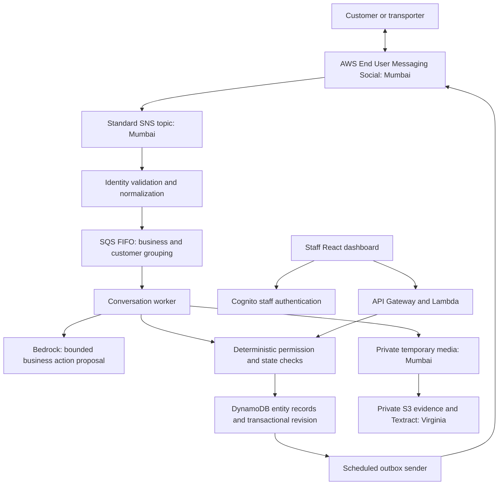

# TradeLoop architecture

TradeLoop is a new distributor communication application. Its initial workspace contains fictional business records. Kaysons is an existing logistics application; no production connection or authorization bypass is enabled.

## Boundaries

- Bedrock proposes a typed intent. Application code executes permitted operations and produces record-backed replies. This is bounded workflow orchestration; no arbitrary SQL, shell, refund or discount tool exists.
- Inbound identity comes from an allowlisted WhatsApp origination identity and a server-side contact binding. A phone number printed inside a message cannot grant access.
- Staff identity comes from verified Cognito ID tokens and `tl:<business>:<role>` group membership. No user-supplied business header selects production records.
- Customer claims, extracted document readings, and accepted delivery facts remain separate. A file upload does not accept POD or authorize freight payment.
- A customer-confirmed request is not a stock reservation, invoice or fulfilled sale.
- Prices are fictional catalogue values. No tax calculation, customer-specific commercial terms or live stock feed is implemented.
- Staff proposals and approvals use current record versions. Completion is a separate staff action with a required note.

## Persistence and delivery

Each business has a DynamoDB partition. Entities, messages, audit events and outbound actions are separate items. A metadata revision and changed items are committed together in an optimistic transaction, retried on conflicts. Local mode uses atomic file replacement and a per-business lock.

SQS FIFO serializes a customer's queued WhatsApp events. Application message IDs prevent repeated events from creating duplicate records. The sender claims an outbox item before invoking AWS; an ambiguous provider result becomes `uncertain` and is not blindly retried. A process crash after the claim can leave `sending` for operator investigation. Provider delivery-status reconciliation is not yet implemented; `sent` means accepted by the provider, not delivered to the recipient.

Before sending, follow-ups recheck consent and unresolved cases. Freeform messages require a real inbound customer session. Simulator messages and transporter messages do not open the customer's WhatsApp session. Outside the service window an approved, appropriately categorized template and consent are required. Both configured templates must accept one body text parameter.

## Prototype scaling limits

The current dashboard loads the business partition and the store uses a revision per business. This is simple to inspect and suitable for the bounded demonstration, but it is not validated for a large distributor. Large histories require indexed customer/case queries, pagination, record-level optimistic concurrency, event retention, due-date indexes, rate limiting and load tests. DynamoDB transactions are limited to 100 operations. Resetting a large synthetic workspace can exceed that bound.

One real WhatsApp business connection is supported by this stack. A second synthetic business is used for isolation tests. Self-service onboarding, carrier/GPS feeds, role-specific read projections, full multilingual document extraction, and external ERP write-back are future work.

## AWS deployment

`infra/app.ts` deploys an authenticated dashboard/API, Cognito, DynamoDB, private S3, inbound SNS, FIFO queue and dead-letter queue, worker and sender Lambdas, CloudWatch alarms and a one-minute sender schedule. The application is in Virginia; the active WhatsApp account, its SNS topic and temporary media bucket are in Mumbai. `scripts/prepare-whatsapp-region.ts` prepares the regional resources. CDK owns the cross-region SNS subscription and scoped invocation permission. The regional resources are separate from the main stack and require explicit teardown. No notification recipient is attached to the alarms. WhatsApp requires the linked account, origin identity, current Meta version and authorized contact bindings. SES remains disabled in TradeLoop.

On 28 October 2026, two real inbound text messages verified the Mumbai Social Messaging/SNS to Virginia ingestion, SQS FIFO, worker, Bedrock and DynamoDB path. After correcting outbound destinations to plus-prefixed E.164 and deploying that fix, the second enquiry also verified the scheduled cloud sender and visually confirmed reply receipt in the authorized user's desktop WhatsApp. This is actual AWS End User Messaging Social runtime use with synthetic business records. The [sanitized verification record](whatsapp-verification.json) distinguishes the initial controlled local sender check from the later automatic cloud round-trip. A `sent` database record alone still means provider acceptance; the receipt claim for this test additionally relies on observed WhatsApp UI evidence. Live attachment retrieval remains untested, and no production Kaysons connection or completed hackathon submission is claimed.

Database, evidence and user-pool resources are retained on stack deletion to prevent accidental loss. Review them explicitly during eventual teardown. CloudWatch logs expire after seven days. The dedicated stack can incur AWS charges; no always-on VM or NAT gateway is created.
